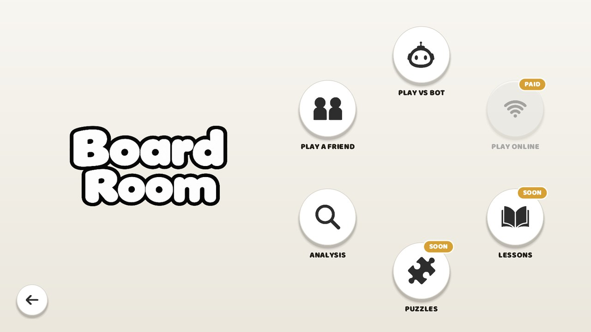

# Scaccomatto Free

Chess, with personality. A free chess game for Windows and Linux by Alekhine Studios.

**[Download the latest version](../../releases/latest)** or visit the [website](https://curious3dofficial.github.io/scaccomatto-download/).

Play a friend on one computer in seven variants, from Classic to Duck Chess. Take on four bots, each with a story of their own, from Gary at 300 up to Margot at 2200. Watch two bots play each other in Spectate, or dig into a position on the analysis board with Argus, our own engine.

Online play, Game Review, accounts and achievements are in the full version of Scaccomatto, coming soon on Steam and itch.io. Puzzles, Lessons and Spell Chess are on the way for both.

**Windows:** run `Scaccomatto-Free-Setup-<version>.exe`. If Windows says "Windows protected your PC", click *More info*, then *Run anyway*.

**Linux:** `sudo apt install ./scaccomatto-free_<version>_amd64.deb`

Found a problem? Email alekhinestudios@gmail.com

© 2026 Alekhine Studios
